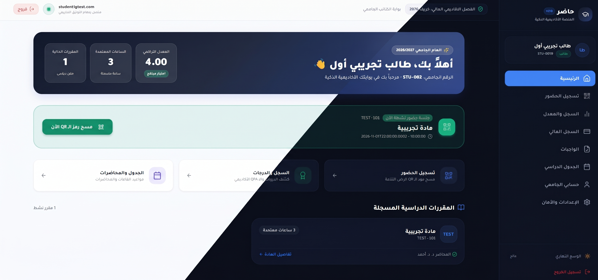

<div align="center">
  
# 🎓 حاضر (Hadir)
**المنصة الأكاديمية الذكية لإدارة الحضور، الدرجات والشؤون المالية والأمنية**

[](https://reactjs.org/)
[](https://nodejs.org/)
[](https://www.typescriptlang.org/)
[](https://www.mysql.com/)
[](https://tailwindcss.com/)
[](#-معايير-الأمان-والحماية-السيبرانية-owasp)

**حاضر (Hadir)** هو نظام جامعي متكامل وعالي الأمان لإدارة الحضور الذكي، دفتر الدرجات الأكاديمي، الشؤون المالية، وجداول المحاضرات للجامعات والمعاهد الحديثة. يدمج بين سلاسة تجربة المستخدم (UI/UX متجاوب ومرن مع وضع ليلي عالي التباين) وأعلى معايير الحماية السيبرانية والدفاع الاستباقي.

<br>

<br><br>

---
</div>

## 📑 جدول المحتويات
- [✨ أبرز المميزات والإضافات الجديدة (v2.1)](#-أبرز-المميزات-والإضافات-الجديدة-v21)
- [🛡️ معايير الأمان والحماية السيبرانية (OWASP)](#-معايير-الأمان-والحماية-السيبرانية-owasp)
- [📂 هيكلية المشروع](#-هيكلية-المشروع-repository-structure)
- [🚀 البدء السريع والتشغيل](#-البدء-السريع-والتشغيل-quick-start)
- [🧪 تشغيل حزمة الاختبارات الشاملة (Tests)](#-تشغيل-حزمة-الاختبارات-الشاملة-tests)
- [🔑 حسابات تجريبية للاختبار السريع](#-حسابات-تجريبية-للاختبار-السريع)
- [🛠️ التقنيات والمكتبات المستخدمة](#-التقنيات-والمكتبات-المستخدمة)
- [📄 الترخيص](#-الترخيص-license)

---

## ✨ أبرز المميزات والإضافات الجديدة (v2.1)

### 1. ⏱️ رمز الـ QR الديناميكي المتغير (20s Rotating QR):
* **تشفير زمني HMAC-SHA256**: توليد رمز حضور متغير تلقائياً كل **20 ثانية** مع عداد تنازلي حي.
* **منع الحضور عن بعد وتصوير الشاشة**: لا يمكن للغائبين استخدام لقطات الشاشة أو الرموز المرسلة عبر برامج المراسلة نظراً لانتهاء صلاحية الرمز خلال ثوانٍ معدودة.

### 2. 📊 محرك الدرجات الأكاديمي الشامل (معايير Moodle 4.0):
* **تخصيص كامل لأوزان التقييم**: يمكن للمحاضر تحديد وتعديل توزيع درجات المقرر (واجبات، كويزات، نصفي، عملي، نهائي) مع فرض قاعدة المجموع الإلزامي 100%.
* **المعدل التراكمي الفوري (4.0 GPA)**: احتساب فوري للمعدل الفصلي والتراكمي للطالب وفق معيار الـ 4 نقاط، مع عرض تفصيلي لكشف الدرجات.

### 3. 🏛️ إدارة القاعات والجداول الدراسية (Admin Control):
* **تخصيص القاعات والمواعيد**: يمتلك مدير النظام لوحة تحكم كاملة لتحديد أيام المحاضرات، توقيتها، واسم القاعة (مثل: *قاعة إدوارد سنودن - مدرج 101*).
* **جدول الطالب المتجاوب**: عرض جدول أسبوعي تفاعلي مدعوم بأيقونات تحديد المواقع الجغرافية ومؤشرات القاعات.

### 4. 💳 السجل المالي الجامعي وتجميد الحسابات:
* **قسم مالي مستقل**: كشف حساب منفصل لكل طالب يوضح إجمالي الرسوم، المبالغ المسددة، المتبقي، وتاريخ الدفعات.
* **إدارة المدفوعات والإيصالات**: تسجيل أذونات الدفع النقدية والبنكية مع أرقام إيصالات فريدة لكل معاملة.
* **آلية التجميد الأكاديمي**: إمكانية تجميد حساب الطالب في حال التأخر المالي وحظر تسجيل الحضور أو تسليم الواجبات مع إشعار توضيحي، وفك التجميد فور السداد.

### 5. 🛠️ أدوات الدعم الفني وتأمين الحسابات:
* **إعادة تعيين كلمة المرور**: إمكانية قيام المشرف بتعيين كلمة مرور مؤقتة للطلاب عند نسيانها لتسهيل استعادة الحسابات.
* **خيارات الأمان المتقدمة**: مصادقة ثنائية (2FA) وإمكانية تسجيل الخروج وإبطال الجلسات من كافة الأجهزة المتصلة بضغطة زر واحدة.

### 6. 🎨 الواجهة الأمامية والوضع الليلي المحسّن (UI/UX):
* **Dark Mode عالي التباين**: اعتماد درجات الأزرق الداكن والرمادي الفحمي (`#090D16`) لراحة العين والوضوح الفائق.
* **تصميم مرن (Fully Responsive)**: ملاءمة كاملة لجميع الشاشات من هواتف ذكية وأجهزة لوحية وحواسيب محمولة.

---

## 🛡️ معايير الأمان والحماية السيبرانية (OWASP)

تم تصميم وبناء بنية النظام التحتية وفق مبدأ **الدفاع في العمق (Defense in Depth)**:

* **حقن قواعد البيانات (SQL Injection)**: استعلامات مجهزة بالكامل (Prepared Statements) مدعومة بمدقق `securitySanitizer` المسبق لفلترة المعاملات.
* **البرمجة النصية عبر المواقع (XSS)**: تعقيم صارم لكافة الحقول المدخلة، وترويس التصفح المشفر عبر `Helmet` و `Content-Security-Policy`.
* **فيض المخزن المؤقت (Buffer Overflow)**: قيود مشددة على أطوال النصوص المدخلة (Max Length) وسعة الحزم (Body Size Limits).
* **فحص وتطهير الملفات المرفوعة**:
  * فحص الامتدادات المزدوجة والمشبوهة (مثل: `.pdf.exe`, `.php.png`).
  * حظر مطلق للملفات التنفيذية والسكربتات (`.exe, .bat, .sh, .php, .js`).
  * قبول مستندات الأبحاث والواجبات المعتمدة (`.pdf, .doc, .docx, .zip` حتى **50 ميجابايت**).
* **مكافحة الهجمات الشرسة (Anti-Brute Force)**: محدد طلبات ذكي لمسارات تسجيل الدخول مع استثناء محاولات الدخول الناجحة وتوفير أداء فائق.
* **أمان التزامن (Concurrency & Race Condition Prevention)**: منع ازدواجية تسجيل الحضور عبر القيود الفريدة ومعاملات `InnoDB Transactions`.

---

## 📂 هيكلية المشروع (Repository Structure)

```text
Hadir/
├── Backend/                         # خادم النظام (Node.js, Express & TypeScript)
│   ├── src/
│   │   ├── config/                  # ضبط قاعدة البيانات ومفاتيح JWT
│   │   ├── middleware/              # طبقات التحقق، الصلاحيات، والتعقيم الأمني
│   │   │   ├── authenticate.ts      # فحص الجلسات وإبطال التوكنات وتجميد الحسابات
│   │   │   ├── fileValidator.ts     # الفحص الصارم لنوع وحجم الملفات المرفوعة
│   │   │   └── securitySanitizer.ts # التعقيم الفوري للمدخلات ضد SQLi و XSS
│   │   ├── routes/                  # مسارات الـ API (حضور، درجات، مالية، أمان)
│   │   ├── schemas/                 # مخططات التحقق من صحة البيانات (Zod)
│   │   ├── scripts/                 # سكربتات التهيئة وترقية جداول النظام
│   │   ├── services/                # منطق الأعمال (محرك الدرجات، الحضور، الحسابات)
│   │   └── server.ts                # نقطة الانطلاق وإعداد خادم Express
│   └── tests/                       # حزم الاختبارات الأمنية والوظيفية واختبارات الضغط
│       ├── security/                # اختبارات Jest للأمان والـ RBAC
│       └── system_master_test.cjs   # السكربت الشامل لفحص المنظومة بالكامل
│
├── eduflow-portal-main/             # الواجهة الأمامية (React 18 + Vite + Tailwind)
│   ├── src/
│   │   ├── components/
│   │   │   ├── admin/               # إدارة المقررات، المستخدمين، والشؤون المالية
│   │   │   ├── auth/                # واجهة تسجيل الدخول والمصادقة الثنائية
│   │   │   ├── dashboards/          # لوحات التحكم (الطالب، المعلم، المدير)
│   │   │   ├── student/             # كشف الدرجات، الحضور، والجدول مع القاعات
│   │   │   ├── teacher/             # دفتر درجات Moodle، وبدء جلسة الـ QR (20s)
│   │   │   └── shared/              # الإعدادات، المظهر، وتغيير كلمات السر
│   │   ├── contexts/                # إدارة حالة المصادقة (AuthContext) والمظهر (Theme)
│   │   └── index.css                # تصميم الألوان والوضع الليلي الداكن
│   └── vite.config.ts               # إعدادات Vite ومنافذ التشغيل
│
└── README.md                        # دليل المشروع الشامل
```

---

## 🚀 البدء السريع والتشغيل (Quick Start)

### المتطلبات المسبقة:
- **[Node.js](https://nodejs.org/)** (الإصدار 18 أو 20+).
- **[MySQL Server 8.0](https://www.mysql.com/)** شغال محلياً.

### 1️⃣ إعداد وتشغيل الخادم (Backend)
1. انتقل لمجلد الخادم وثبت الحزم:
   ```bash
   cd Backend
   npm install
   ```
2. أنشئ ملف المتغيرات `.env` بناءً على النموذج:
   ```bash
   cp .env.example .env
   ```
3. عدل بيانات الاتصال بقاعدة البيانات في ملف `.env` (`DB_PASSWORD`، `DB_NAME=eduflow_db`).
4. قم بتهيئة وترقية جداول قاعدة البيانات وزرع البيانات الأولية:
   ```bash
   npm run seed
   node src/scripts/migrate_schedule.js
   node src/scripts/migrate.js
   ```
5. شغّل الخادم في وضع التطوير (يعمل على المنفذ `3000`):
   ```bash
   npm run dev
   ```

### 2️⃣ تشغيل الواجهة الأمامية (Frontend)
في نافذة طرفية (Terminal) منفصلة:
```bash
cd eduflow-portal-main
npm install
npm run dev
```
ستعمل الواجهة على المنفذ `8091`. يمكنك تصفح المنظومة عبر الرابط: **`http://localhost:8091`**

---

## 🧪 تشغيل حزمة الاختبارات الشاملة (Tests)

يحتوي النظام على حزمتي اختبار متكاملتين لضمان استقرار الإنتاج:

### أ) اختبارات الأمان والـ RBAC (Jest Security Suite)
```bash
cd Backend
npm run test:security
```
*تتحقق من سلامة التوكنات، منع هجمات إعادة التشغيل (Replay Attacks)، وتصريح الصلاحيات (RBAC).*

### ب) الفحص الشامل واختبارات الضغط والتزامن (Master E2E Benchmark)
```bash
cd Backend
npm run test:master
```
*يقوم بمحاكاة هجمات SQLi و XSS واقعية، تدقيق رفع الملفات، فحص دوران الـ QR كود (20s)، احتساب الـ GPA الموزون، وإطلاق **60 طلباً متزامناً** لقياس معدل الاستجابة وتحمل الضغط العالي بنسبة نجاح **100%**.*

---

## 🔑 حسابات تجريبية للاختبار السريع

تتضمن الواجهة أزرار تعبئة سريعة بنقرة واحدة للحسابات التجريبية:

| الدور (Role) | البريد أو المعرف (Identifier) | كلمة المرور (Password) | الصلاحيات والوظائف المتاحة |
| :--- | :--- | :--- | :--- |
| **مدير النظام (Admin)** | `admin` | `admin123` | إدارة المقررات والقاعات، إدارة المستخدمين، كشف الحسابات المالية، تجميد الحسابات، والدعم الفني. |
| **المحاضر (Teacher)** | `teacher@test.com` | `password123` | إنشاء جلسات الحضور (QR 20s)، إدارة المحاضرات والملفات، وتخصيص أوزان درجات Moodle. |
| **الطالب (Student)** | `student1@test.com` | `password123` | مسح رمز الـ QR، استعراض كشف الدرجات ومعدل الـ GPA، جدول المحاضرات بالقاعات، والسجل المالي. |

---

## 🛠️ التقنيات والمكتبات المستخدمة

<div align="center">

### الواجهة الأمامية (Frontend)


### الخادم الخلفي (Backend)


### الأمان والتشفير (Security & Cryptography)


</div>

---

## 📄 الترخيص (License)
هذا المشروع متاح للاستخدام الأكاديمي والمفتوح (Open Source Educational License).  
ماعدى علي البي , ممنوع .
